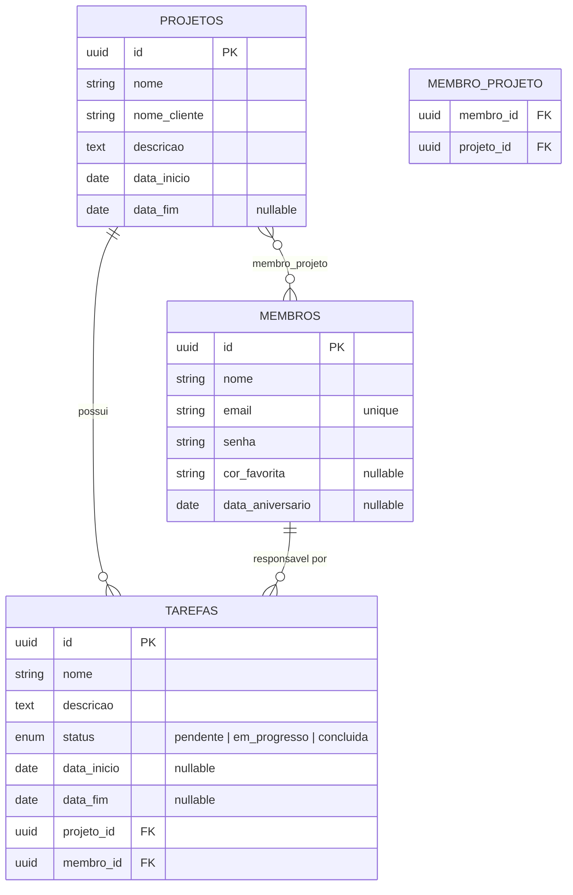

# Adapti Project Template
## Iniciando projeto
Clone o projeto para sua máquina:
```bash
    git clone link-do-projeto
```
### Laravel
Dentro da pasta `backend` siga as seguintes instruções.
1. Instale as dependências:
    ```bash
    composer install
    ```
2. Crie o arquivo de variáveis globais do projeto **backend**:
    ```bash
    cp .env.example .env
    ```
3. Após isso insira as credenciais do banco de dados no arquivo `.env`
4. Crie o schema no banco de dados. O nome do banco deve ser o valor contido na variável `DB_DATABASE` presente no arquivo `.env`. 
5. Gere a chave do projeto:
    ```bash
    php artisan key:generate
    ```
6. Crie o link simbólico com o diretório storage:
    ```bash
    php artisan storage:link
    ```
7. Rode as migrations:
    ```bash
    php artisan migrate --seed
    ```
   1. Caso as migrations já tenham sido rodadas anteriormente no seu banco de dados, execute o comando:
        ```bash
        php artisan migrate:fresh --seed
        ```
8. Inicie o servidor **backend**:
    ```bash
    php artisan serve
    ```
    1. O servidor **backend** será iniciado por padrão no endereço `http://127.0.0.1:8000`. 
### React.js/Next.js
Tenha o gerenciador de pacotes <a href="https://pnpm.io/pt/installation">pnpm</a> instalado globalmente em sua máquina.

Dentro da pasta `frontend` siga as seguintes instruções.
1. Instale as dependências:
    ```bash
    pnpm install
    ```
2. Crie o arquivo de variáveis globais do projeto **frontend**:
    ```bash
    cp .env.local.example .env.local
    ```
3. Inicie o servidor **frontend**:
    ```bash
    pnpm dev
    ```
    1. O servidor **frontend** será iniciado por padrão no endereço `http://127.0.0.1:3000`. 

---

# Desafio Técnico PS 2026.2: Sistema de Gestão de Projetos MEJ

As seções abaixo documentam tudo o que foi **adicionado ou alterado** sobre o projeto base. As instruções de instalação acima permanecem as mesmas; aqui constam apenas observações complementares.

## Sumário
1. [Observações complementares de configuração](#1-observações-complementares-de-configuração)
2. [Modelagem de dados](#2-modelagem-de-dados)
3. [Regra de negócio: trava de alocação](#3-regra-de-negócio-trava-de-alocação)
4. [Decisões arquiteturais](#4-decisões-arquiteturais)
5. [Documentação da API](#5-documentação-da-api)
6. [Missão 1: bugs corrigidos](#6-missão-1-bugs-corrigidos)
7. [Missão 2: novas funcionalidades](#7-missão-2-novas-funcionalidades)
8. [Extras](#8-extras)
9. [Demonstração visual](#9-demonstração-visual)
10. [Roteiro de testes manuais](#10-roteiro-de-testes-manuais)

## 1. Observações complementares de configuração

**Login de teste** (criado pelo seeder):

| Campo | Valor |
|---|---|
| E-mail | `test@example.com` |
| Senha | `password` |

**Banco de dados:** o projeto foi desenvolvido com MySQL. No `.env` do backend:
```env
DB_CONNECTION=mysql
DB_HOST=127.0.0.1
DB_PORT=3306
DB_DATABASE=ps-desafio-2026-2
DB_USERNAME=root
DB_PASSWORD=
```

**Variáveis do frontend** (`.env.local`):
```env
NEXT_PUBLIC_API_URL=http://localhost:8000
NEXT_PUBLIC_API_DOMAIN=localhost
AUTH_TRUST_HOST=http://localhost:3000
AUTH_SECRET=<segredo gerado, ex.: openssl rand -base64 32>
```

**Endereço de acesso:** como as variáveis acima usam `localhost`, acesse o frontend por `http://localhost:3000` (e não `127.0.0.1`), para que os cookies de sessão funcionem corretamente.

**Problemas comuns**

| Sintoma | Solução |
|---|---|
| `ERR_TOO_MANY_REDIRECTS` após recriar o banco | Apague os cookies de `localhost` (ou use janela anônima) e faça login novamente. O cookie antigo aponta para um token que não existe mais. |
| Rota ou classe não encontrada após alterações | `php artisan optimize:clear`, `composer dump-autoload` e reinicie o `php artisan serve`. |
| Login falha após `migrate:fresh` | Rode com `--seed` para recriar o usuário de teste. |

## 2. Modelagem de dados



**Relacionamentos (Eloquent)**

| Relação | Tipo | Onde |
|---|---|---|
| Projeto → Tarefas | 1:N (`hasMany`) | `Projeto::tarefas()` |
| Membro → Tarefas | 1:N (`hasMany`) | `Membro::tarefas()` |
| Tarefa → Projeto | N:1 (`belongsTo`) | `Tarefa::projeto()` |
| Tarefa → Membro | N:1 (`belongsTo`) | `Tarefa::membro()` |
| Projeto ↔ Membro | N:N (`belongsToMany`, pivô `membro_projeto`) | `Projeto::membros()` / `Membro::projetos()` |

**Escolhas de modelagem**
- **UUID** como chave primária (`HasUuids`), seguindo o padrão de `projetos` e `membros`. As chaves estrangeiras de `tarefas` usam `foreignUuid` para manter os tipos compatíveis.
- Cada tarefa pertence a **um projeto** e é atribuída **obrigatoriamente a um membro**.
- `data_inicio` e `data_fim` das tarefas são opcionais; quando `data_fim` existe, deve ser igual ou posterior a `data_inicio`.
- O `status` é um conjunto fechado (`pendente`, `em_progresso`, `concluida`), validado no backend e exibido como `select` no frontend.

## 3. Regra de negócio: trava de alocação

**Requisito:** um projeto pode ter vários membros, mas um membro **não pode estar em mais de 2 projetos ativos simultaneamente**.

**Definição de "projeto ativo":** `data_fim` nula ou igual/posterior à data de hoje. É derivada das datas existentes (sem coluna extra) e implementada no scope `Projeto::ativos()`.

**Funcionamento** (`POST /projetos/{id}/vincular-membro`):
1. Valida se `membro_id` existe.
2. Verifica se o membro já está vinculado ao projeto (evita duplicidade).
3. Se o projeto de destino é ativo e o membro já possui **2 projetos ativos**, bloqueia com `422` e a mensagem *"O membro já está alocado em 2 projetos ativos."*
4. Caso contrário, cria o vínculo na tabela `membro_projeto`.

Projetos encerrados não contam para o limite, e não há limite de membros por projeto. No frontend, a mensagem do backend aparece imediatamente em um toast de erro no modal de vincular membro.

## 4. Decisões arquiteturais

- **Server Actions para Tarefas** (`frontend/src/actions/tarefa.ts`), seguindo o padrão de Membros e Projetos. O token Bearer permanece no servidor, e isso evita o erro que ocorre quando uma requisição `POST/PUT/DELETE` é feita direto do navegador com `Origin` do front.
- **Form Requests** (`StoreTarefaRequest`, `UpdateTarefaRequest`) concentram a validação e retornam erros `422` legíveis.
- **Mensagens de erro do backend** chegam ao usuário: a action de tarefas serializa explicitamente `message`, `status` e `errors`, pois o `JSON.stringify` de um `Error` perde a propriedade `message`.


## 5. Documentação da API

Base URL: `http://localhost:8000`. As rotas exigem os headers:
```
Accept: application/json
Authorization: Bearer <token>
```
O token do usuário logado fica disponível em `http://localhost:3000/api/auth/session` (campo `user.token`).

### Tarefas

| Método | Rota | Descrição | Sucesso |
|---|---|---|---|
| GET | `/tarefas` | Lista tarefas, incluindo `projeto` e `membro` | `200` |
| POST | `/tarefas` | Cria tarefa | `201` |
| GET | `/tarefas/{id}` | Detalha tarefa, incluindo `projeto` e `membro` | `200` |
| PUT | `/tarefas/{id}` | Atualiza tarefa | `200` |
| DELETE | `/tarefas/{id}` | Remove tarefa | `204` |

**Corpo de `POST /tarefas`**

| Campo | Tipo | Regra |
|---|---|---|
| `nome` | string | obrigatório, máx. 255 |
| `descricao` | string | obrigatório |
| `projeto_id` | uuid | obrigatório, existe em `projetos` |
| `membro_id` | uuid | obrigatório, existe em `membros` |
| `status` | string | obrigatório: `pendente`, `em_progresso` ou `concluida` |
| `data_inicio` | date | opcional |
| `data_fim` | date | opcional, igual ou posterior a `data_inicio` |

`PUT /tarefas/{id}` aceita os mesmos campos, todos opcionais (`sometimes`).

Exemplo de resposta de `GET /tarefas/{id}`:
```json
{
  "id": "a30e375b-1f26-4c8c-9096-c12812e04250",
  "nome": "Primeira tarefa",
  "descricao": "Teste",
  "status": "pendente",
  "data_inicio": "2026-10-24",
  "data_fim": null,
  "projeto_id": "a30d4242-605e-493a-9def-c2698e543444",
  "membro_id": "uuid-do-membro",
  "projeto": { "id": "a30d4242-605e-493a-9def-c2698e543444", "nome": "Projeto A" },
  "membro": { "id": "uuid-do-membro", "nome": "Fulano", "email": "fulano@email.com" }
}
```

Exemplo de erro de validação (`422`):
```json
{
  "message": "The data fim field must be a date after or equal to data inicio.",
  "errors": { "data_fim": ["..."] }
}
```

### Projetos

| Método | Rota | Alteração |
|---|---|---|
| GET | `/projetos` e `/projetos/{id}` | Passam a incluir o array `membros` (`id`, `nome`, `email`) com os membros alocados |
| POST | `/projetos` | `data_fim` (opcional) deve ser posterior a `data_inicio` |
| PUT | `/projetos/{id}` | `data_fim` opcional e posterior a `data_inicio` |
| POST | `/projetos/{id}/vincular-membro` | **Nova.** Corpo: `{ "membro_id": "uuid" }` |

Respostas de `POST /projetos/{id}/vincular-membro`:

| Status | Situação | Corpo |
|---|---|---|
| `201` | Vínculo criado | `{ "message": "Membro vinculado ao projeto com sucesso." }` |
| `422` | Já vinculado a este projeto | `{ "message": "Membro já vinculado a este projeto." }` |
| `422` | Membro já em 2 projetos ativos | `{ "message": "O membro já está alocado em 2 projetos ativos." }` |
| `422` | `membro_id` ausente ou inexistente | `{ "message": "...", "errors": { "membro_id": [...] } }` |
| `404` | Projeto não encontrado | `{ "message": "..." }` |

### Membros

| Método | Rota | Alteração |
|---|---|---|
| POST | `/membros` | E-mail único e válido; senha obrigatória e forte |
| PUT | `/membros/{id}` | E-mail único ignorando o próprio membro; senha preservada quando não enviada |

## 6. Missão 1: bugs corrigidos

### Backend

| Problema | Correção | Onde verificar |
|---|---|---|
| Projeto aceitava `data_fim` anterior a `data_inicio` | Regra `after:data_inicio` no cadastro e na edição | `StoreProjetoRequest`, `UpdateProjetoRequest` |
| `data_fim` obrigatória na edição do projeto (inconsistente com o cadastro) | Passou a ser `nullable` | `UpdateProjetoRequest` |
| Membro sem validação de e-mail único/válido | `email` + `unique:membros,email` (ignorando o próprio registro na edição) | `StoreMembroRequest`, `UpdateMembroRequest` |
| Membro cadastrado sem senha obrigatória | `required` + regra de senha forte | `StoreMembroRequest` |
| Edição de membro sem senha podia apagá-la | Senha vazia removida do payload antes do `update` | `MembroController@update` |
| `authorize()` retornando `false` bloqueava ações com 403 | Ajustado para `true` | Form Requests |

### Frontend

| Problema | Correção | Onde verificar |
|---|---|---|
| `new Date(data_fim)` exibia "Invalid Date" sem término e deslocava um dia por fuso | Função `formatDate` sem dependência de fuso; exibe "—" quando vazio | `list-project.tsx` |
| Listagem de projetos quebrava em telas pequenas | Tabela com rolagem horizontal, colunas secundárias ocultas no mobile (`max-sm:hidden`), ações em `div` flex dentro da célula | `list-project.tsx` |
| Sidebar ocupava a tela inteira no mobile | Altura limitada com rolagem em telas pequenas | `admin/layout.tsx` |

## 7. Missão 2: novas funcionalidades

**Backend:** migration e model `Tarefa`; `TarefaController` (CRUD); `StoreTarefaRequest` e `UpdateTarefaRequest`; relacionamentos `membros()`, `projetos()`, `tarefas()` e scope `ativos()`; trava de alocação em `ProjetoController@vincularMembro`.

**Frontend:** aba **Tarefas** na sidebar (`/admin/tarefas`); listagem com skeleton (Suspense), status legível e layout responsivo; modais de criar, editar, visualizar e excluir tarefas, com selects de projeto e membro; modal de **vincular membro** na listagem de projetos, exibindo o erro da trava.

```
frontend/src/app/(dashboard)/admin/tarefas/
├── page.tsx
└── _components/
    ├── list-tarefas.tsx
    ├── skeleton-tarefas.tsx
    ├── form-fields-tarefa.tsx
    ├── dialog-create-tarefa.tsx
    ├── dialog-update-tarefa.tsx
    ├── dialog-delete-tarefa.tsx
    └── dialog-information-tarefa.tsx
frontend/src/actions/tarefa.ts
```

## 8. Extras

- **Membros alocados visíveis nos modais de informação:** o modal de informações do **projeto** lista os membros alocados (com contagem e mensagem quando não há nenhum), e o da **tarefa** mostra o projeto e o membro responsável. *Como verificar:* vincule membros a um projeto e clique no botão de informações (ícone "i") na listagem de projetos e na de tarefas. Arquivos: `dialog-information-project.tsx`, `dialog-information-tarefa.tsx`, `ProjetoController` e `TarefaController` (`with(...)` em `index` e `show`).
- **Status como `select`** no formulário de tarefas, evitando valores inválidos digitados à mão. *Verificar:* `form-fields-tarefa.tsx`.

## 9. Demonstração visual

Prints das interfaces e validações: **https://drive.google.com/drive/folders/198SfPBIJG38nvevS-hza_8UyPB2d451B?usp=sharing**


## 10. Roteiro de testes manuais

**Trava de alocação**
1. Crie 3 projetos ativos (P1, P2, P3) e os membros A, B e C.
2. Vincule A a P1 e P2: sucesso.
3. Vincule A a P3: erro `422` exibido na tela.
4. Vincule A a P1 novamente: erro "já vinculado".
5. Vincule A, B e C a P1: sucesso (sem limite por projeto).
6. Defina `data_fim` no passado em P1 e vincule A a P3: sucesso (projeto encerrado não conta).

**Tarefas**
1. Crie uma tarefa completa e outra sem datas: ambas aparecem na lista.
2. Tente criar sem projeto ou sem membro: erro de validação legível.
3. Tente `data_fim` anterior a `data_inicio`: erro de validação.
4. Edite nome, status e datas: atualização refletida, com projeto e membro selecionados no modal.
5. Abra o botão de informações: projeto e responsável aparecem.
6. Exclua uma tarefa: some da lista.

**Missão 1**
1. Cadastre projeto com `data_fim` anterior ao início: erro.
2. Edite projeto sem `data_fim`: sem erro.
3. Cadastre membro com e-mail repetido, e-mail inválido e senha fraca: erros legíveis.
4. Edite um membro sem alterar a senha: sem erro e senha preservada.
5. Redimensione para 375 px em Projetos e Tarefas: sem estouro horizontal.


**API (Postman):** `GET /tarefas` sem token retorna `401`; com token retorna `200`; `POST /tarefas` sem campos retorna `422` com `errors`.