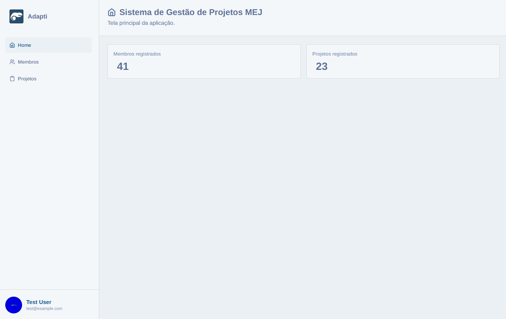
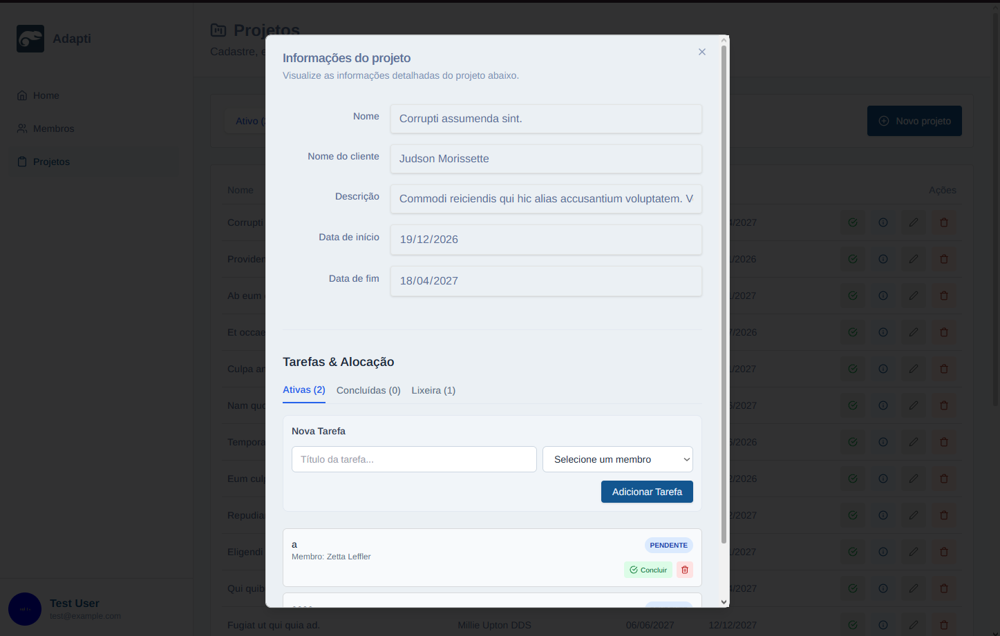
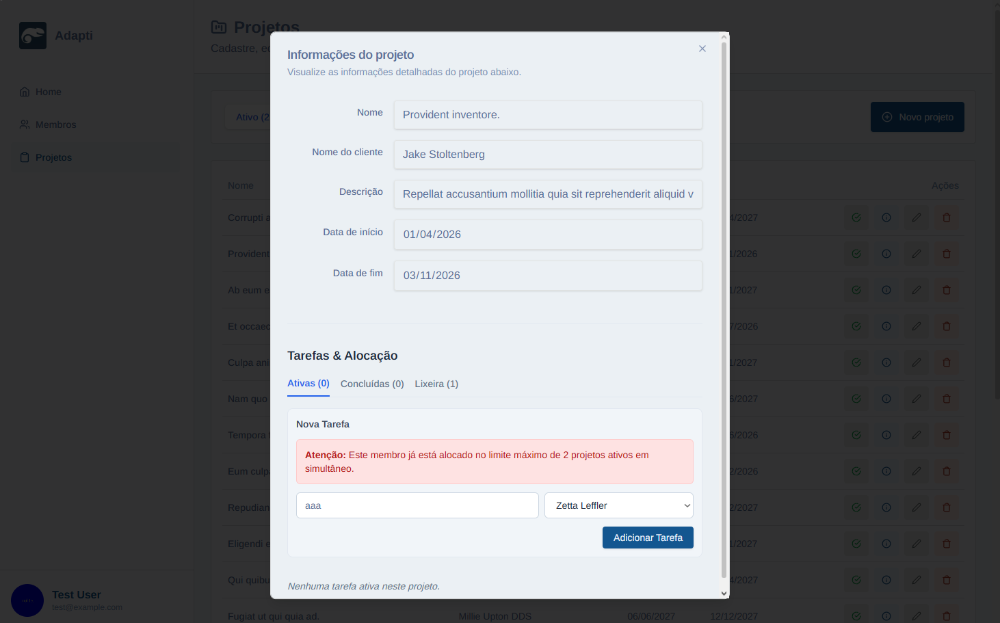
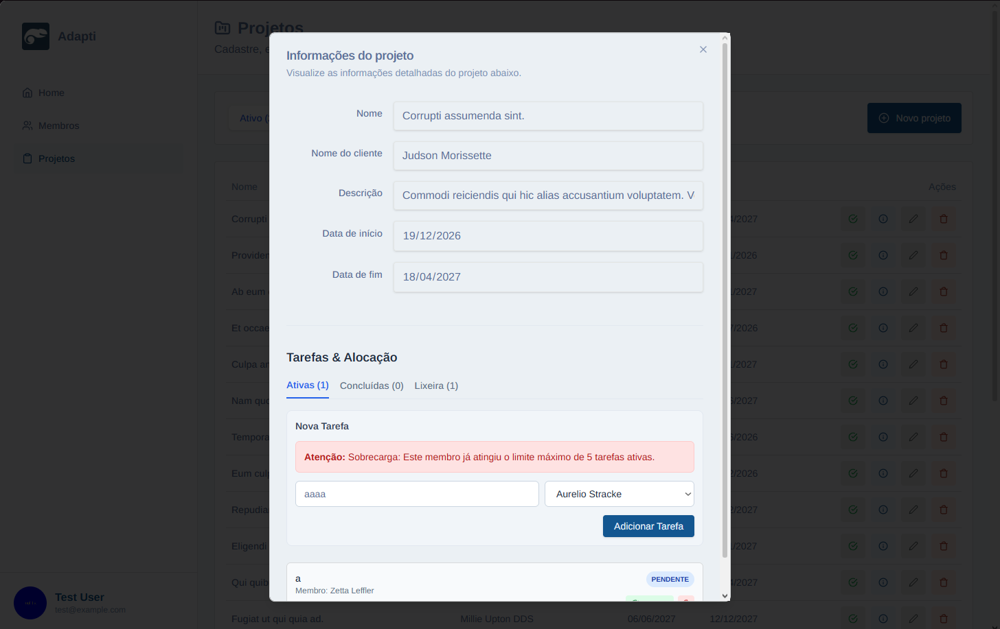
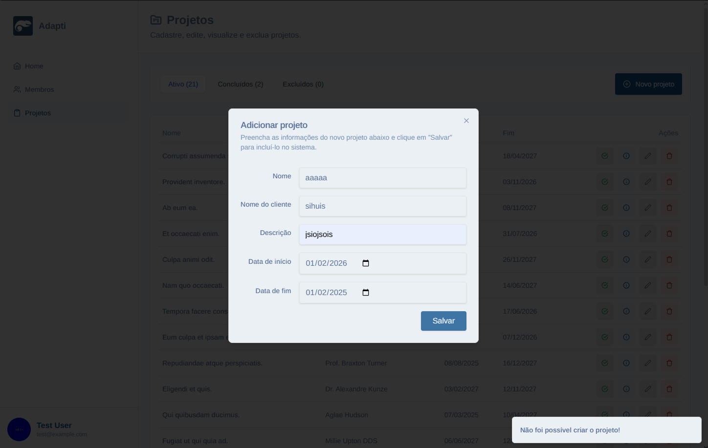
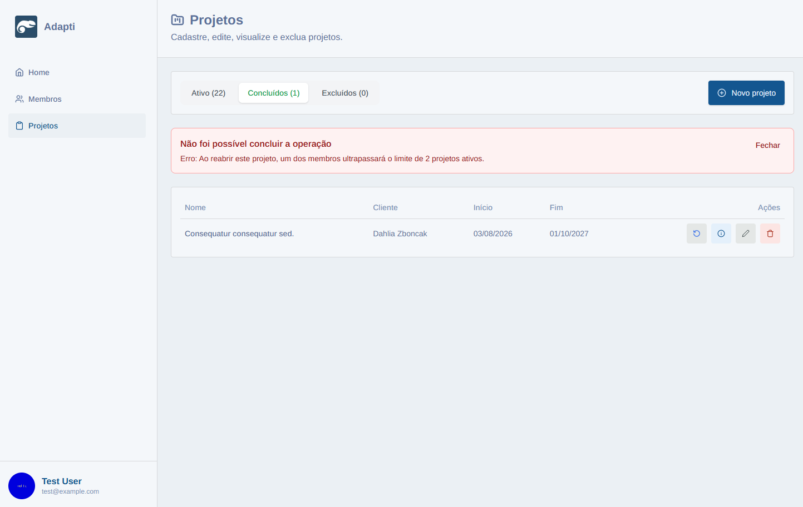

# Sistema de Gestão de Projetos MEJ — Desafio Técnico Adapti

Este repositório contém a solução desenvolvida para o Desafio Técnico do Processo Seletivo Adapti 2026.2. A aplicação consiste em um sistema Full-Stack para gestão interna de projetos, membros e tarefas de Empresas Juniores.

---

## Tecnologias Utilizadas

- **Frontend:** Next.js (React), TypeScript, Tailwind CSS, Lucide Icons, NextAuth.js.
- **Backend:** Laravel (PHP), Eloquent ORM, Laravel Sanctum, SQLite/MySQL.
- **Ferramentas e Versionamento:** Git, pnpm/npm, Composer, VS Code.

---

## Guia de Configuração e Execução Local

### Pré-requisitos
- Node.js (v18+) e pnpm/npm
- PHP (v8.2+) e Composer

---

### Clonando o Repositório

Para executar o sistema localmente, primeiro é necessário obter uma cópia do projeto disponível no GitHub.

1. Acesse o repositório do projeto no GitHub.
2. Clique no botão **Code** e copie a URL HTTPS do repositório.
3. Abra um terminal na pasta em que deseja armazenar o projeto.
4. Execute:

```bash
git clone https://github.com/juliapsantos-wq/ps-desafio-2026-2.git
```

5. Acesse a pasta clonada:

```bash
cd ps-desafio-2026-2
```

A estrutura principal do projeto está organizada em dois diretórios:

- `backend/`: aplicação Laravel, responsável pela API, regras de negócio e persistência de dados.
- `frontend/`: aplicação Next.js, responsável pela interface e comunicação com a API.

A configuração de cada aplicação deve ser realizada separadamente, conforme as instruções a seguir.

### 1. Configurando o Backend (Laravel)

1. Navegue até a pasta do backend:
   cd backend

2. Instale as dependências do PHP:
   composer install

3. Copie o arquivo de ambiente e gere a chave da aplicação:
   cp .env.example .env
   php artisan key:generate

   #### Configuração do Banco de Dados (MySQL)

   O sistema utiliza MySQL para armazenar os dados de projetos, membros, tarefas e usuários.

   Antes de executar as migrations, é necessário configurar a conexão com o banco de dados.

   **1. Inicie o servidor MySQL**

   Certifique-se de que o serviço MySQL esteja em execução. É possível utilizar ferramentas como XAMPP ou uma instalação local do MySQL.

   **2. Crie o banco de dados**

   Utilizando o MySQL ou a interface do phpMyAdmin, execute:

   ```sql
   CREATE DATABASE IF NOT EXISTS mej_gestao
   CHARACTER SET utf8mb4
   COLLATE utf8mb4_unicode_ci;
   ```

   O nome `mej_gestao` é uma sugestão e pode ser alterado conforme a configuração local.

   **3. Configure as variáveis de ambiente**

   No arquivo `backend/.env`, configure as variáveis de conexão:

   ```env
   DB_CONNECTION=mysql
   DB_HOST=127.0.0.1
   DB_PORT=3306
   DB_DATABASE=mej_gestao
   DB_USERNAME=seu_usuario_mysql
   DB_PASSWORD=sua_senha_mysql
   ```

   Substitua o usuário e a senha pelas credenciais da sua instalação do MySQL.

   Caso escolha outro nome para o banco, atualize também a variável `DB_DATABASE`.

   **4. Execute as migrations e os Seeders**

   Com o banco configurado, execute no terminal da pasta `backend`:

   ```bash
   php artisan migrate --seed
   ```

   Esse comando cria as tabelas definidas nas migrations e executa os Seeders registrados no `DatabaseSeeder.php`, populando o banco com dados iniciais para desenvolvimento.

   **Observação:** recomenda-se executar esse procedimento de povoamento em um banco novo de desenvolvimento, evitando inserir dados de teste duplicados em um banco já utilizado.

4. Execute as migrações e popule o banco de dados (Seeders):
   php artisan migrate --seed

5. Inicie o servidor do Laravel:
   php artisan serve

*O backend estará rodando em http://localhost:8000.*

---

### 2. Configurando o Frontend (Next.js)

1. Em um novo terminal, navegue até a pasta do frontend:
   cd frontend

2. Instale as dependências:
   pnpm install  # ou npm install

3. Crie o arquivo .env.local configurando a URL da API e a chave do NextAuth (use o arquivo .env.local.example como base):
   NEXT_PUBLIC_API_URL=http://localhost:8000
   NEXTAUTH_SECRET=sua_chave_secreta_aqui
   NEXTAUTH_URL=http://localhost:3000

4. Inicie o servidor de desenvolvimento:
   pnpm dev  # ou npm run dev

*O frontend estará acessível em http://localhost:3000.*

---

## Decisões Arquiteturais e Modelagem de Dados

### Estrutura do Banco de Dados
A modelagem integra três entidades principais através de relacionamentos no Eloquent ORM:

- **Projetos (`projetos`):** `id` (UUID, PK), `nome`, `nome_cliente`, `descricao`, `data_inicio`, `data_fim`, `status`, `justificativa_exclusao`.
   A entidade utiliza identificadores UUID como chave primária e implementa exclusão lógica (*Soft Deletes*), permitindo a recuperação de projetos excluídos. O campo `status` representa a situação atual do projeto, enquanto `justificativa_exclusao` armazena o motivo de sua exclusão.
- **Membros (`membros`):** `id` (PK), `nome`, `email`, `cargo`.
- **Tarefas (`tarefas`):** `id` (PK), `titulo`, `status`, `projeto_id` (FK), `membro_id` (FK).

#### Relacionamentos entre as entidades

A modelagem do sistema é baseada em três entidades principais: **Projetos, Membros e Tarefas**.

- **Projeto → Tarefa (1:N):** um projeto pode possuir várias tarefas, enquanto cada tarefa pertence a um único projeto.
- **Membro → Tarefa (1:N):** um membro pode ser responsável por várias tarefas, enquanto cada tarefa deve possuir obrigatoriamente um membro responsável.
- **Tarefa → Projeto (N:1):** cada tarefa pertence a um projeto específico.
- **Tarefa → Membro (N:1):** cada tarefa é atribuída a um membro específico.

**Relacionamento entre Membros e Projetos**

O vínculo entre membros e projetos é estabelecido indiretamente pelas tarefas. Dessa forma, quando um membro recebe uma tarefa de determinado projeto, ele passa a ser considerado alocado naquele projeto.

Não é necessário criar um vínculo independente entre membro e projeto, pois a alocação é identificada a partir das tarefas cadastradas.

Para verificar a quantidade de projetos em que um membro está alocado, o sistema deve considerar os **projetos ativos distintos** associados às suas tarefas.

Por exemplo, se um membro possui três tarefas no Projeto A e duas tarefas no Projeto B, considera-se que ele está alocado em apenas dois projetos.

Essa estrutura permite que um projeto tenha vários membros trabalhando simultaneamente, respeitando a regra de negócio que limita cada membro a, no máximo, dois projetos ativos distintos.

---

### Lógica da Trava de Alocação de Membros

Para evitar a sobrecarga dos integrantes da Empresa Júnior, foram implementadas duas regras de negócio complementares: o limite de participação em projetos ativos e o limite de tarefas ativas por membro.

#### 1. Definição de Projeto Ativo

O sistema considera ativo um projeto cujo campo `status` possui o valor `ativo`.

A identificação de projetos ativos é baseada nesse status, permitindo que projetos em execução continuem sendo considerados ativos mesmo quando ultrapassam a data de término originalmente prevista.

#### 2. Limite de Dois Projetos Ativos

Cada membro pode participar de, no máximo, **2 projetos ativos distintos simultaneamente**.

Como a alocação ocorre por meio das tarefas, o sistema consulta os projetos aos quais o membro está vinculado e contabiliza apenas os projetos ativos distintos.

Para essa contagem:

- São considerados projetos com `status = 'ativo'`.
- Tarefas com `status = 'excluida'` são desconsideradas.
- Múltiplas tarefas de um membro no mesmo projeto representam apenas uma alocação.
- Tarefas concluídas ainda podem representar o vínculo do membro com um projeto ativo.

Antes de criar uma tarefa em um novo projeto ativo, o backend verifica se o membro já está associado a dois outros projetos ativos.

Caso esteja, a operação é bloqueada e a API retorna um erro HTTP `422 Unprocessable Entity`.

A regra não impede a criação de novas tarefas em projetos nos quais o membro já está alocado, desde que seja respeitado o limite de tarefas ativas.

Projetos concluídos não entram na contagem dos dois projetos ativos. Assim, a criação de tarefas nesses projetos é permitida pela regra de alocação, desde que as demais validações sejam atendidas.

#### 3. Limite de Cinco Tarefas Ativas

Como funcionalidade adicional, foi implementado um limite de **5 tarefas ativas simultâneas por membro**.

Essa restrição tem como objetivo evitar a concentração excessiva de atividades em um único integrante.

Para a contagem das tarefas ativas, o sistema desconsidera aquelas com status `concluida` ou `excluida`.

Quando o membro já possui cinco tarefas ativas, o backend impede novas atribuições e retorna a mensagem:

> Sobrecarga: Este membro já atingiu o limite máximo de 5 tarefas ativas.

Ao concluir ou excluir uma tarefa, o membro recupera capacidade para receber novas atribuições.

Essa regra é independente do limite de projetos e se aplica também às tarefas criadas em projetos concluídos.

#### 4. Implementação no Backend

As validações são implementadas na classe `StoreTarefaRequest.php`, utilizando o recurso Form Request do Laravel.

O processo de validação consulta as tabelas de tarefas e projetos para verificar:

1. A existência do projeto e do membro informados.
2. A quantidade de tarefas ativas atribuídas ao membro.
3. A quantidade de projetos ativos distintos em que o membro já possui tarefas.
4. O status do projeto que receberá a nova tarefa.

Somente após a aprovação dessas validações, o método `store()` do `TarefaController` realiza a persistência dos dados utilizando `$request->validated()`.

Em situações inválidas, a API retorna um erro HTTP `422`, impedindo a criação da tarefa.

#### 5. Tratamento de Erros no Frontend

O frontend utiliza o cliente de API da aplicação para receber e tratar as respostas do Laravel.

Quando alguma regra de alocação ou de sobrecarga é violada, o usuário recebe uma mensagem de erro na interface, informando o motivo pelo qual a operação não pôde ser concluída.

Essa abordagem evita falhas silenciosas e permite que o usuário compreenda as restrições do sistema.

#### 6. Testes Realizados

As seguintes situações foram testadas e aprovadas:

- Alocação de um membro em até dois projetos ativos distintos.
- Bloqueio de uma tentativa de alocação em um terceiro projeto ativo.
- Exibição de mensagem de erro adequada no frontend.
- Permissão de criação de tarefa em projeto concluído, mesmo quando o membro já está alocado em dois projetos ativos, respeitando o limite de tarefas.
- Bloqueio da criação de uma sexta tarefa ativa.

As validações garantem o cumprimento das regras testadas durante a criação de tarefas.

---

## Documentação da API

| Método | Endpoint | Descrição |
|---|---|---|
| `GET` | `/projetos` | Lista projetos agrupados em `ativo`, `concluidos` e `excluidos`. |
| `POST` | `/projetos` | Cadastra um novo projeto. |
| `GET` | `/projetos/{id}` | Consulta um projeto específico. |
| `PUT/PATCH` | `/projetos/{id}` | Atualiza os dados de um projeto. |
| `DELETE` | `/projetos/{id}` | Exclui um projeto. |
| `PATCH` | `/projetos/{id}/status` | Altera o status de um projeto, respeitando as regras de alocação. |
| `POST` | `/projetos/{id}/restore` | Restaura um projeto excluído. |
| `GET` | `/membros` | Lista os membros cadastrados. |
| `POST` | `/membros` | Cadastra um novo membro. |
| `GET` | `/membros/{id}` | Consulta um membro específico. |
| `PUT/PATCH` | `/membros/{id}` | Atualiza os dados de um membro. |
| `DELETE` | `/membros/{id}` | Exclui um membro. |
| `GET` | `/tarefas` | Lista tarefas e seus relacionamentos com projetos e membros. |
| `POST` | `/tarefas` | Cria uma tarefa, validando os limites de alocação e sobrecarga. |
| `GET` | `/tarefas/{id}` | Consulta uma tarefa específica. |
| `PUT/PATCH` | `/tarefas/{id}` | Atualiza uma tarefa. |
| `DELETE` | `/tarefas/{id}` | Exclui uma tarefa. |

### Detalhamento dos Endpoints

#### Cadastro de Tarefas

**Endpoint:** `POST /tarefas`

**Descrição:** Cadastra uma nova tarefa vinculada obrigatoriamente a um projeto e a um membro responsável.

**Parâmetros:**

| Campo | Tipo | Obrigatório | Descrição |
|---|---|---|---|
| `titulo` | string | Sim | Título da tarefa, com até 255 caracteres. |
| `descricao` | string | Não | Descrição detalhada da tarefa. |
| `projeto_id` | UUID | Sim | Identificador de um projeto existente. |
| `membro_id` | UUID | Sim | Identificador de um membro existente. |

**Resposta de sucesso — HTTP 201 Created:**

A API retorna um objeto JSON com os dados da tarefa cadastrada, incluindo os relacionamentos `projeto` e `membro`.

**Resposta de erro — HTTP 422 Unprocessable Entity:**

O Laravel retorna um erro de validação quando algum campo é inválido ou quando uma das regras de negócio é violada.

As principais validações são:

- O título da tarefa é obrigatório.
- O projeto informado deve existir no banco de dados.
- O membro responsável deve existir no banco de dados.
- Um membro não pode participar de mais de dois projetos ativos distintos simultaneamente.
- Um membro não pode possuir mais de cinco tarefas ativas simultaneamente.

O backend utiliza a classe `StoreTarefaRequest` para validar essas regras antes de permitir a criação da tarefa.

#### Gerenciamento de Projetos

A API disponibiliza operações para cadastro, consulta, atualização, exclusão lógica, alteração de status e restauração de projetos.

**Listagem de Projetos — `GET /projetos`**

Retorna os projetos cadastrados, organizados em três categorias:

- `ativo`: projetos com status `ativo`.
- `concluidos`: projetos com status `concluido`.
- `excluidos`: projetos excluídos logicamente, recuperados por meio do método `onlyTrashed()` do Eloquent.

As listagens incluem os relacionamentos entre projetos, tarefas e membros responsáveis.

**Resposta de sucesso:** HTTP `200 OK`.

**Cadastro de Projetos — `POST /projetos`**

Cria um novo projeto utilizando os dados previamente validados pela classe `StoreProjetoRequest`.

**Resposta de sucesso:** HTTP `201 Created`, contendo o projeto cadastrado.

**Consulta de Projeto — `GET /projetos/{id}`**

Retorna os dados do projeto correspondente ao identificador informado.

**Resposta de sucesso:** HTTP `200 OK`.

**Atualização de Projeto — `PUT/PATCH /projetos/{id}`**

Atualiza os dados de um projeto existente por meio das validações definidas em `UpdateProjetoRequest`.

**Resposta de sucesso:** HTTP `200 OK`, contendo o projeto atualizado.

**Exclusão de Projeto — `DELETE /projetos/{id}`**

Realiza a exclusão lógica de um projeto, preservando seu registro no banco de dados.

A operação exige o parâmetro:

| Campo | Tipo | Obrigatório | Validação |
|---|---|---|---|
| `justificativa_exclusao` | string | Sim | Mínimo de 5 caracteres |

A justificativa é armazenada antes da exclusão lógica, permitindo consultar posteriormente o motivo da remoção.

**Resposta de sucesso — HTTP 200 OK:**

```json
{
  "message": "Projeto excluído com sucesso."
}
```

**Alteração de Status — `PATCH /projetos/{id}/status`**

Permite alterar o status de um projeto entre `ativo` e `concluido`, conforme as ações disponibilizadas na interface.

Parâmetro utilizado:

| Campo | Tipo | Descrição |
|---|---|---|
| `status` | string | Novo status solicitado para o projeto. |

Ao tentar reativar um projeto concluído, o backend verifica se algum membro vinculado às suas tarefas ultrapassaria o limite de dois projetos ativos.

Se a regra for violada, a operação é bloqueada com HTTP `422 Unprocessable Entity` e uma mensagem explicativa.

**Restauração de Projeto — `POST /projetos/{id}/restore`**

Restaura um projeto anteriormente excluído logicamente.

Se o projeto possuir status `ativo`, o backend verifica previamente se sua restauração provocaria uma violação do limite de dois projetos ativos por membro.

Quando a operação é permitida, a justificativa de exclusão é removida e o projeto é restaurado.

**Resposta de sucesso — HTTP 200 OK:**

```json
{
  "message": "Projeto restaurado com sucesso."
}
```

**Tratamento de Erros**

As operações podem retornar erros de validação HTTP `422`, além de respostas HTTP `404` quando o registro solicitado não é encontrado.

As mensagens retornadas pelo backend são utilizadas pelo frontend para informar o motivo de operações não permitidas, incluindo tentativas de reativação ou restauração que violem as regras de alocação.

#### Validação dos Dados de Projetos

O cadastro e a atualização de projetos utilizam classes Form Request do Laravel para validar os dados recebidos pela API.

**Cadastro — `StoreProjetoRequest`**

Os seguintes campos são obrigatórios:

| Campo | Tipo esperado | Descrição |
|---|---|---|
| `nome` | Texto | Nome do projeto |
| `nome_cliente` | Texto | Nome do cliente |
| `descricao` | Texto | Descrição do projeto |
| `data_inicio` | Data | Data de início do projeto |
| `data_fim` | Data | Data prevista para o término |

A validação utiliza a regra `after_or_equal:data_inicio`, impedindo o cadastro de projetos cuja data de término seja anterior à data de início.

**Edição — `UpdateProjetoRequest`**

A atualização utiliza as mesmas validações de datas, acrescentando regras explícitas de tipo e tamanho para os campos textuais:

- `nome`: string obrigatória, com até 255 caracteres.
- `nome_cliente`: string obrigatória, com até 255 caracteres.
- `descricao`: string obrigatória.
- `data_inicio`: data válida e obrigatória.
- `data_fim`: data válida e obrigatória, igual ou posterior à data de início.

Na implementação atual, todos esses campos são obrigatórios durante a atualização, inclusive nas requisições `PATCH`.

**Tratamento de erros**

Quando os dados não atendem às regras, o Laravel interrompe a operação e retorna os erros de validação. Nas requisições JSON da API, esses erros são apresentados com status HTTP `422 Unprocessable Entity`.

Uma das mensagens personalizadas implementadas é:

> A data de término não pode ser anterior à data de início.

Essa validação garante a consistência das informações temporais dos projetos e impede registros com datas incompatíveis.

---

## Manutenção e Correção de Bugs

Durante a fase de manutenção e auditoria do código herdado, foram identificados e corrigidos os seguintes problemas:

1. **Validação de Datas no Backend:** Adicionada regra de validação na criação de projetos para impedir datas de término anteriores à data de início.
2. **Inconsistências em Membros:** Adicionada validação de e-mail único e sanitização de campos no cadastro de membros.
3. **Loop de Redirecionamento no Frontend:** Ajustado o arquivo `middleware.ts` do NextAuth, resolvendo o bug de loop infinito de redirecionamentos ao tentar acessar páginas administrativas.
4. **Ícones Desatualizados (`react-icons/lu`):** Corrigidos os nomes dos ícones que estavam quebrando o layout do sistema (`LuHouse` alterado para `LuHome`, e `LuCirclePlus` alterado para `LuPlusCircle`).
5. **Comunicação de API (CSRF e CORS):** Adequada a rota de tarefas (`routes/api.php`) isentando-a de verificações de estado Sanctum conflitantes no ambiente de desenvolvimento, e refatorado o payload de submissão do frontend (`dialog-information-project.tsx`) para usar corretamente o utilitário `api()` pré-configurado com a propriedade `data`.
6. **Tratamento Visual de Erros na Alteração de Status dos Projetos:** Foi aprimorada a experiência do usuário na listagem de projetos, substituindo os alertas nativos do navegador (`alert()`) por mensagens de erro integradas à interface, estilizadas com Tailwind CSS.
A implementação foi realizada no componente `list-project.tsx`, utilizando o hook `useState` do React para controlar a exibição das mensagens retornadas pela API Laravel.
Quando uma operação de alteração de status ou restauração de projeto falha, o sistema apresenta um alerta visual contendo a descrição do erro e uma opção para dispensar a mensagem.
Essa melhoria foi validada por meio de três testes funcionais:
- Exibição correta da mensagem de erro na interface.
- Funcionamento do botão para fechar o alerta.
- Preservação do status do projeto após uma tentativa de reativação bloqueada.
7. **Aprimoramento das Validações de Status e Alocação de Projetos:** Foram realizadas melhorias no `ProjetoController.php` para garantir a consistência das regras de negócio durante as operações de alteração de status, reativação e restauração de projetos.

As principais melhorias incluem:

- **Validação do status:** o método `updateStatus()` passou a aceitar exclusivamente os valores `ativo` e `concluido`, utilizando a validação do Laravel. Valores inválidos são rejeitados com HTTP `422`.
- **Consistência na contagem de alocações:** o método `membroExcedeLimite()` foi ajustado para desconsiderar tarefas com status `excluida` ao contabilizar os projetos ativos associados a um membro.
- **Reativação e restauração:** a seleção dos membros vinculados aos projetos também passou a desconsiderar tarefas excluídas, evitando bloqueios indevidos durante essas operações.

**Testes funcionais realizados:**

1. Reativação de projeto sem violação do limite de alocação — aprovado.
2. Bloqueio de reativação que ultrapassaria dois projetos ativos por membro — aprovado.
3. Desconsideração de tarefas excluídas na verificação de alocações — aprovado.

Essas melhorias reforçam a integridade das regras de negócio e a confiabilidade das operações de gerenciamento de projetos.

---


## Demonstração Visual

As capturas de tela a seguir demonstram as principais funcionalidades
implementadas e as validações realizadas no sistema.

### 1. Dashboard

Tela principal com os indicadores de membros e projetos
cadastrados, obtidos por meio da API Laravel.



### 2. Cadastro de Tarefas

Interface de criação de tarefas, permitindo vincular cada tarefa
a um projeto e atribuí-la obrigatoriamente a um membro responsável.



### 3. Bloqueio do Terceiro Projeto Ativo

Demonstração da regra de negócio que impede um membro de
participar de mais de dois projetos ativos distintos simultaneamente.



### 4. Controle de Sobrecarga de Tarefas

Validação adicional que impede a atribuição de mais de cinco
tarefas ativas simultaneamente a um mesmo membro.



### 5. Validação de Datas dos Projetos

Mensagem de erro apresentada quando a data de término
informada é anterior à data de início do projeto.



### 6. Bloqueio de Reativação de Projetos

Alerta integrado à interface, exibido quando a reativação
de um projeto faria algum membro ultrapassar o limite
de dois projetos ativos.



---


## Extras e Diferenciais Implementados

- **Tipagem Rigorosa em TypeScript:** Uso de interfaces padronizadas (`membroType`, `projetoType`, `tarefaType`) aplicadas nos componentes React.
- **Custom API Client Dinâmico:** Integração do frontend via cliente customizado `api()` do projeto, com tratamento de exceções para apresentar mensagens amigáveis baseadas no status de retorno do Laravel.
- **Form Requests no Laravel:** Organização do código de validação do lado do servidor em classes dedicadas, mantendo os Controllers enxutos e seguindo boas práticas de arquitetura MVC.
- **Controle de Sobrecarga de Tarefas:** Implementada uma regra de negócio adicional que limita a atribuição de tarefas a, no máximo, **5 tarefas ativas simultâneas por membro**. A validação é realizada no backend, por meio da classe `StoreTarefaRequest`, antes da criação de uma nova tarefa.
Para a contagem, são desconsideradas as tarefas com status `concluida` ou `excluida`. Dessa forma, a conclusão ou exclusão de uma tarefa libera a capacidade do membro para receber novas atribuições.
Quando o limite é atingido, a API retorna um erro de validação HTTP `422`, impedindo a criação da tarefa e informando que o membro atingiu sua capacidade máxima.