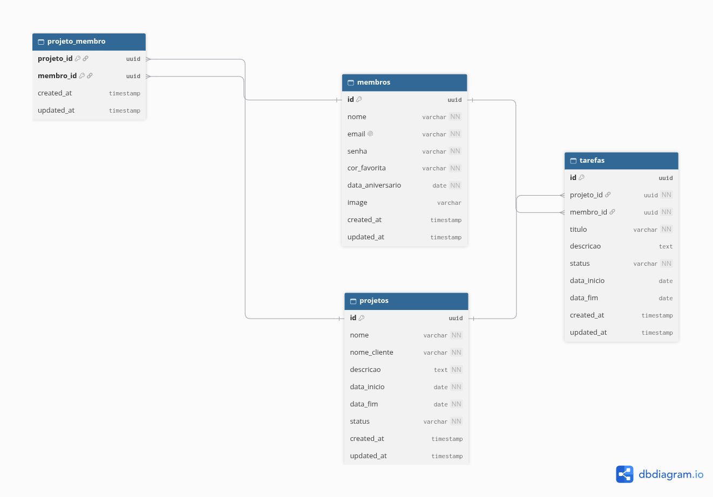

# Adapti Project Template
# Sistema de Gestão para Empresas Juniores (MEJ)

Desafio Técnico Adapti (PS 2026.2). Backend em **Laravel**, frontend em **Next.js** com **Tailwind CSS**.

**Autora:** Cecília do Valle ([@cecidovalle](https://github.com/cecidovalle))

---

## 1. Configuração e execução

Pré-requisitos: PHP 8.3, Composer, Node 22, [pnpm](https://pnpm.io/pt/installation) e um banco (MySQL ou SQLite).

```bash
git clone https://github.com/cecidovalle/ps-desafio-2026-2.git
cd ps-desafio-2026-2
```

### Backend (pasta `backend`)

1. Instale as dependências:
   ```bash
   composer install
   ```
2. Crie o arquivo de variáveis de ambiente:
   ```bash
   cp .env.example .env
   ```
3. Configure o banco no `.env`:
   - **MySQL:** crie um schema com o nome de `DB_DATABASE` e preencha usuário e senha.
   - **SQLite (alternativa):** use `DB_CONNECTION=sqlite`, comente as linhas `DB_HOST`, `DB_PORT`, `DB_DATABASE`, `DB_USERNAME` e `DB_PASSWORD`, e rode `touch database/database.sqlite`.
4. Gere a chave do projeto:
   ```bash
   php artisan key:generate
   ```
5. Crie o link simbólico do storage:
   ```bash
   php artisan storage:link
   ```
6. Rode as migrations com os seeders:
   ```bash
   php artisan migrate --seed
   ```
   Se o banco já tinha migrations antigas, use `php artisan migrate:fresh --seed` (apaga os dados).
7. Inicie o servidor:
   ```bash
   php artisan serve
   ```
   Ele sobe em `http://127.0.0.1:8000`.

### Frontend (pasta `frontend`)

1. Instale as dependências:
   ```bash
   pnpm install
   ```
2. Crie o arquivo de variáveis de ambiente:
   ```bash
   cp .env.local.example .env.local
   ```
3. No `.env.local`, a URL da API **precisa terminar em `/api`**:
   ```
   NEXT_PUBLIC_API_URL=http://localhost:8000/api
   ```
4. Inicie o servidor:
   ```bash
   pnpm dev
   ```
5. Acesse `http://localhost:3000`.

Os **dois servidores precisam estar ligados** ao mesmo tempo.

**Login de teste (criado pelo seed):** `test@example.com` / `password`


## 2. Decisões arquiteturais e modelagem



### Tabelas e relacionamentos

- `projeto_membro` (tabela principal): relação N:N entre projetos e membros, com chave primária composta `(projeto_id, membro_id)`, que impede o mesmo membro duas vezes no mesmo projeto.
- `tarefas`: cada tarefa pertence a **um projeto** e a **um membro** (`membro_id` obrigatório). Relações 1:N.
- Eloquent:
  - `Projeto::membros()` e `Membro::projetos()` (`belongsToMany`)
  - `Projeto::tarefas()` e `Membro::tarefas()` (`hasMany`)
  - `Tarefa::projeto()` e `Tarefa::membro()` (`belongsTo`)
- `projetos.status` (`ativo`, `concluido`, `cancelado`): só `ativo` conta na trava.
- Todos os ids são UUID. Apagar um projeto remove as alocações e tarefas dele (`cascade`); apagar um membro com tarefas é bloqueado (`restrict`).
- `authorize()` dos Requests retorna `true`, porque as rotas não exigem login neste desafio.

### Trava de alocação (`ProjetoMembroController@store`)

Valida o `membro_id` e busca projeto e membro (404 se não existirem).

Se o membro já está no projeto, responde 422.

Se o projeto é ativo, conta os projetos ativos do membro na tabela `projeto_membro`.

Se já forem 2 ou mais, responde 422: `"<nome> já está alocado em 2 projetos ativos."`

Caso contrário, aloca e responde 201.

A regra é validada no **backend**, e o frontend exibe a mensagem. Além disso, uma tarefa só pode ser criada para um membro **já alocado** no projeto.


## 3. Missão 1: correções

### Backend

- Projeto não aceita mais `data_fim` anterior a `data_inicio` (`after_or_equal`), no cadastro e na edição (o `UpdateProjetoRequest` estava vazio).
- E-mail de membro único (regra no Request e `unique` no banco), data de aniversário anterior a hoje e senha guardada com hash.
- Erros devolvidos como 422 com mensagem legível.

### Frontend

- A tabela de projetos não quebra mais em telas pequenas: ela rola na horizontal e os botões ficam inteiros.
- As datas apareciam um dia antes do valor da API (conversão de fuso). Agora são lidas direto do texto (função `formatarData`).


## 4. Documentação da API

Base: `http://localhost:8000/api`. Envie o header `Accept: application/json`.

Erros de validação (422): `{ "message": "...", "errors": { "campo": ["..."] } }`

| Recurso | Rotas |
|---|---|
| Login | `POST /login` com `{ "email", "password" }` → 200 com dados do usuário e `token` |
| Membros | `GET /membros`, `POST /membros`, `PUT /membros/{id}`, `DELETE /membros/{id}` |
| Projetos | `GET /projetos`, `POST /projetos`, `PUT /projetos/{id}`, `DELETE /projetos/{id}` |
| Alocação | `POST /projetos/{projeto}/membros` com `{ "membro_id": "uuid" }` |
| Tarefas | `GET /tarefas` (filtro `?projeto_id=`), `POST /tarefas`, `GET`, `PUT` e `DELETE /tarefas/{id}` |

### Campos

- Membro: `nome`, `email` (único), `senha` (mínimo 8 caracteres, com letras maiúsculas e minúsculas, número e símbolo), `cor_favorita`, `data_aniversario` (anterior a hoje), `image` (opcional).
- Projeto: `nome`, `nome_cliente`, `descricao`, `data_inicio`, `data_fim`.
- Tarefa: `projeto_id`, `membro_id`, `titulo` (obrigatórios); `descricao`, `status` (`pendente`, `em_andamento`, `concluida`), `data_inicio`, `data_fim` (opcionais).

### Respostas da alocação

- 201: membro alocado.
- 404: projeto ou membro inexistente.
- 422: `{ "message": "<nome> já está alocado neste projeto." }`
- 422: `{ "message": "<nome> já está alocado em 2 projetos ativos." }` (a trava)

### Respostas de tarefas

- 201 ao criar. O `GET` devolve `projeto` e `membro` como `{ "id", "nome" }`.
- 422: `{ "message": "O membro escolhido não está alocado neste projeto." }`


## 5. Demonstração visual

Prints das telas e dos alertas de erro: https://drive.google.com/drive/folders/1RyEAp2VReL7Z4QN2860K4Dgm_26jN1e-?hl=pt-br


## 6. Extras

**Datas dos aniversários na tela de membros** também corrigidas (apareciam um dia antes). Arquivo: `list-member.tsx`.

**`react-icons` atualizado para 5.7.0:** a versão antiga não tinha ícones usados no menu e na tela de projetos, e a página quebrava. Arquivo: `frontend/package.json`.

**Tarefa só para membro alocado no projeto.** Arquivo: `TarefaController` (`verificarAlocacao`). Para ver: tela de Tarefas, "Nova tarefa", escolha um membro que não está no projeto.