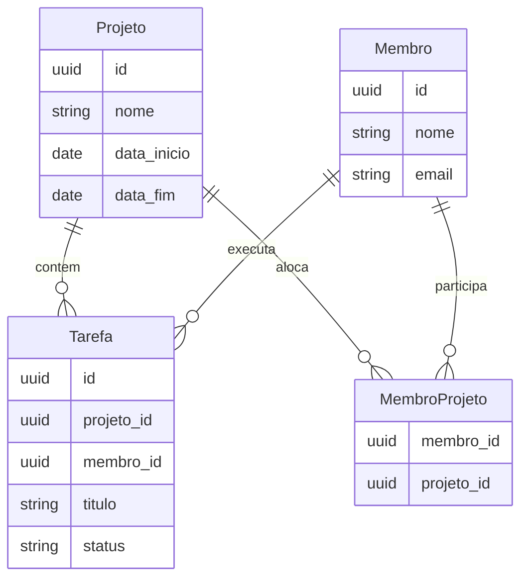

# PS Desafio 2026.2 — Sistema de Gestão de Projetos MEJ

Fork do template Adapti (**Laravel 11** + **Next.js 14**) com:

- **Missão 1** — correções de manutenção (backend + frontend)
- **Missão 2** — Tarefas, pivot N:N e trava de no máximo 2 projetos ativos
- **Missão 3** — documentação, prints, versionamento e diferenciais (tópico 4)

**Login (após seed):** `test@example.com` / `password`  
**Swagger/OpenAPI:** [http://127.0.0.1:8000/docs/api](http://127.0.0.1:8000/docs/api)  
**Branch de entrega (fork):** `entrega/thilon-m`

---

## 1. Guia de Configuração e Execução

### Pré-requisitos

- PHP 8.2+, Composer, MySQL/MariaDB
- Node.js 20+ e [pnpm](https://pnpm.io/pt/installation)

### Clone

```bash
git clone https://github.com/ThilonM/ps-desafio-2026-2.git
cd ps-desafio-2026-2
git checkout entrega/thilon-m
```

### Backend (Laravel)

```bash
cd backend
composer install
cp .env.example .env
```

Configure `DB_*` no `.env` e crie o schema com o nome de `DB_DATABASE`.

```bash
php artisan key:generate
php artisan storage:link
php artisan migrate --seed
# Se já houver migrations antigas no banco:
# php artisan migrate:fresh --seed
php artisan serve
```

- API: `http://127.0.0.1:8000`
- Swagger: `http://127.0.0.1:8000/docs/api`
- Spec: `http://127.0.0.1:8000/docs/openapi.yaml`

### Frontend (Next.js)

```bash
cd frontend
pnpm install
cp .env.local.example .env.local
```

No `.env.local`, aponte a API (ex.: `NEXT_PUBLIC_BACKEND_URL=http://127.0.0.1:8000`).

```bash
pnpm dev
```

App: `http://127.0.0.1:3000`.

---

## 2. Decisões Arquiteturais e Modelagem

### Visão geral

O template já tinha **Projetos** e **Membros**. Foi adicionada a entidade **Tarefa**, a pivot **membro_projeto** (N:N) e a regra de negócio da **trava de alocação**.

```
Projeto 1──N Tarefa N──1 Membro
Projeto N──N Membro   (pivot: membro_projeto)
```

| Tabela | Papel |
|---|---|
| `projetos` | Já existia (nome, cliente, datas) |
| `membros` | Já existia (nome, e-mail, etc.) |
| `membro_projeto` | Pivot N:N (FKs UUID + timestamps) |
| `tarefas` | Nova: `projeto_id`, `membro_id`, `titulo`, `descricao`, `status` + unique `(projeto_id, membro_id, titulo)` |



### Trava de alocação

Implementada em `backend/app/Services/AlocacaoMembroService.php`:

- **Projeto ativo:** `data_inicio <= hoje` **e** `data_fim >= hoje`
- Limite: **2 projetos ativos** por membro
- Dispara em alocação na equipe **e** ao criar tarefa (que também aloca)
- Resposta **422** com mensagem legível; frontend mostra toast

### Validação de feriados (BrasilAPI)

`data_inicio` e `data_fim` de projeto **não podem** cair em feriado nacional:

- Backend: `BrasilApiFeriadosService` + trait `ValidaDatasProjetoNaoFeriado` em `StoreProjetoRequest` / `UpdateProjetoRequest`
- Frontend: checagem espelhada em `frontend/src/services/brasil-api.ts` via Server Actions

### Front

- App Router + Server Actions no padrão do template
- Telas: `/admin`, `/admin/membros`, `/admin/projetos` (equipe), `/admin/tarefas`
- Home com resumo + calendário de projetos (FullCalendar)
- Tailwind; interface em PT-BR

---

## 3. Documentação da API

| Artefato | Caminho / URL |
|---|---|
| OpenAPI 3 | `backend/openapi.yaml` |
| UI Swagger | `GET /docs/api` |
| Spec bruta | `GET /docs/openapi.yaml` |

### Rotas principais (criadas/alteradas)

| Método | Rota | Descrição | Respostas |
|---|---|---|---|
| POST | `/login` | Token Sanctum (`email`, `password`) | 200 / 422 |
| POST | `/logout` | Revoga token | 204 |
| GET/POST | `/membros` | Listar / criar (multipart no create) | 200 / 201 / 422 |
| GET/PUT/DELETE | `/membros/{id}` | CRUD membro | 200 / 422 |
| GET/POST | `/projetos` | Listar / criar | 200 / 201 / **422** (datas / feriado) |
| GET/PUT/DELETE | `/projetos/{id}` | CRUD projeto | 200 / **422** |
| GET | `/projetos/{projeto}/membros` | Equipe | 200 |
| POST | `/projetos/{projeto}/membros` | Alocar (`membro_id`) | 201 / **422** (trava) |
| DELETE | `/projetos/{projeto}/membros/{membro}` | Remover da equipe | 204 |
| GET/POST | `/tarefas` | Listar / criar | 200 / 201 / **422** |
| GET/PUT/DELETE | `/tarefas/{id}` | CRUD tarefa | 200 / 422 |

**Exemplo 422 — trava:**

```json
{
  "message": "…",
  "errors": {
    "membro_id": ["Este membro já está alocado em 2 projetos ativos no mesmo intervalo. Remova-o de outro projeto antes de alocar."]
  }
}
```

**Exemplo 422 — feriado:**

```json
{
  "message": "Não é permitido cadastrar projeto com data de início em feriado nacional (Natal).",
  "errors": {
    "data_inicio": ["Não é permitido cadastrar projeto com data de início em feriado nacional (Natal)."]
  }
}
```

---

## 4. Demonstração Visual

Prints em [`docs/prints/`](docs/prints/):

| # | Arquivo | O que mostra |
|---|---|---|
| 1 | [`01-swagger-openapi.png`](docs/prints/01-swagger-openapi.png) | Swagger/OpenAPI |
| 2 | [`02-login.png`](docs/prints/02-login.png) | Login PT-BR |
| 3 | [`03-home-admin-feriados.png`](docs/prints/03-home-admin-feriados.png) | Home (versão anterior com card de feriados; hoje a BrasilAPI valida datas de projeto) |
| 4 | [`04-membros.png`](docs/prints/04-membros.png) | Membros + coluna Projetos |
| 5 | [`05-projetos.png`](docs/prints/05-projetos.png) | Listagem de projetos |
| 6 | [`06-equipe-projeto.png`](docs/prints/06-equipe-projeto.png) | Diálogo de equipe |
| 7 | [`07-tarefas.png`](docs/prints/07-tarefas.png) | Listagem de tarefas |
| 8 | [`08-tarefa-form.png`](docs/prints/08-tarefa-form.png) | Formulário de tarefa |
| 9 | [`09-validacao-trava-422.png`](docs/prints/09-validacao-trava-422.png) | Toast **422** da trava de alocação |

Regenerar (com API e front no ar):

```bash
node docs/capture-prints.mjs
node docs/capture-prints-extras.mjs
node docs/capture-trava-422.mjs
```

---

## 5. Extras (avaliação)

| Extra | Onde verificar |
|---|---|
| **Swagger/OpenAPI** | `/docs/api` · `backend/openapi.yaml` · `routes/web.php` · `resources/views/swagger.blade.php` |
| **TypeScript rigoroso** | `frontend/tsconfig.json` (`strict`, `noImplicitOverride`, `noFallthroughCasesInSwitch`, `forceConsistentCasingInFileNames`) |
| **Requests / Factory / Seeder de Tarefa** | `StoreTarefaRequest`, `UpdateTarefaRequest`, `TarefaFactory`, `TarefaSeeder` |
| **API externa (BrasilAPI)** | Feriados bloqueiam datas de projeto · `BrasilApiFeriadosService` · `ValidaDatasProjetoNaoFeriado` · `brasil-api.ts` / `actions/projeto.ts` |
| Calendário de projetos na home (FullCalendar) | `projetos-calendar.tsx` em `/admin` |
| PT-BR (labels, toasts, Form Requests) | Telas + `attributes`/`messages` |
| Ordenação de tarefas | `TarefaController@index` (concluídas por último → projeto → título → status → membro) |
| Unique título por membro+projeto | Migration + rules nos Requests |
| Projetos do membro na listagem / dialog ℹ | UI membros + `with('projetos')` |
| Dialog de info sem seletor de imagem em leitura | componente de membros |

Material de estudo interno (não substitui este README): [`docs/COLA_APRESENTACAO.pdf`](docs/COLA_APRESENTACAO.pdf)

---

## 6. Estrutura rápida

```
backend/     API Laravel, migrations, Services, OpenAPI, Swagger
frontend/    Next.js 14 (App Router), dashboard admin
docs/        Prints Missão 3 + cola de apresentação + scripts
```
