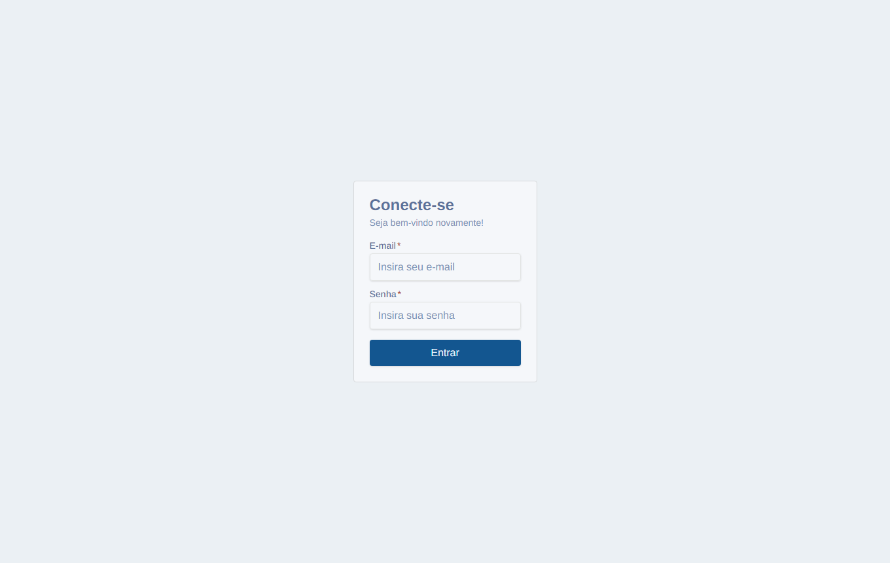
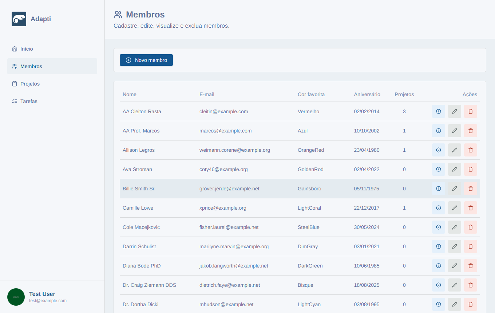
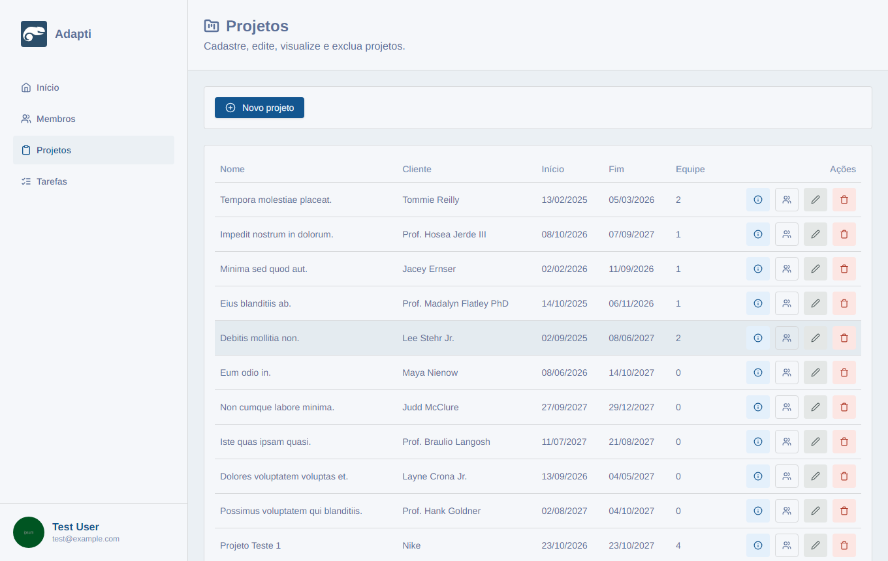
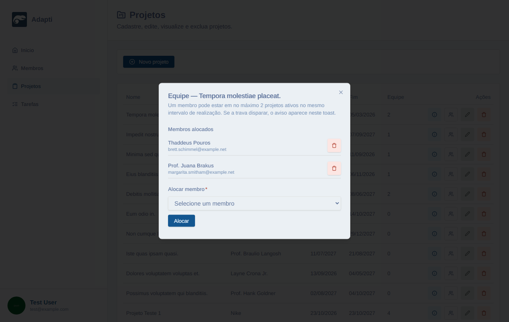
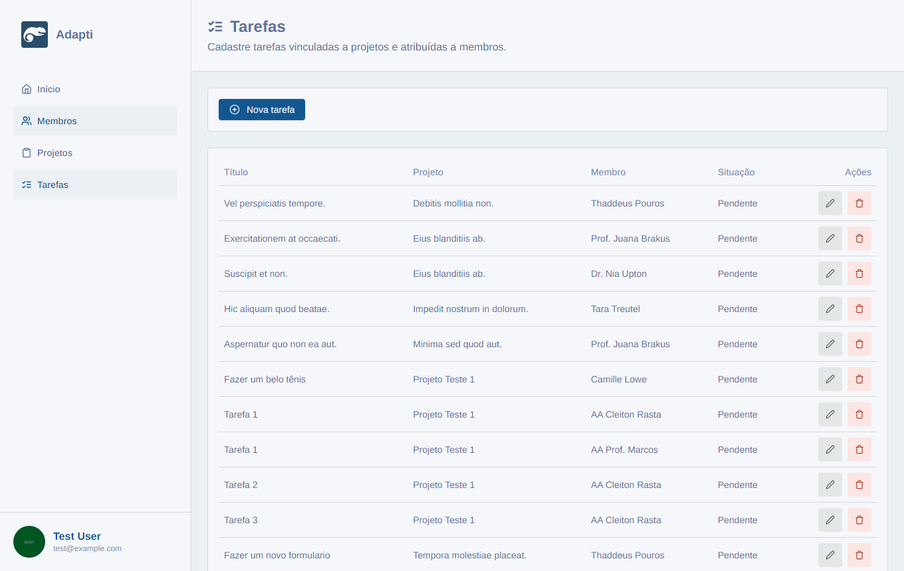
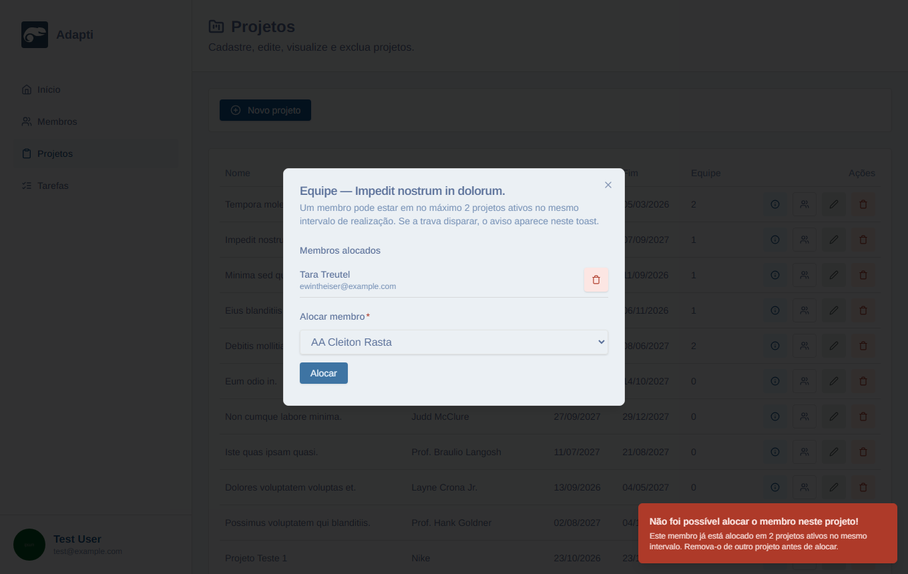
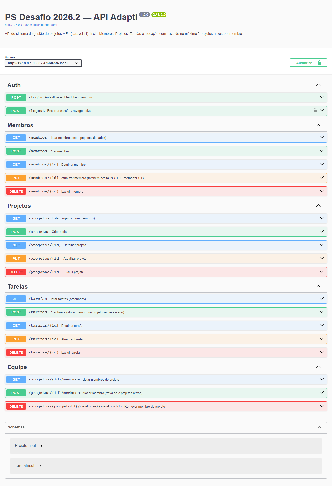

# Cola de apresentação — PS Desafio 2026.2

**Objetivo:** entender **tudo** que mudou no template, para apresentar com segurança.

**Login:** `test@example.com` / `password`  
**Front:** http://127.0.0.1:3000 · **API:** http://127.0.0.1:8000 · **Swagger:** http://127.0.0.1:8000/docs/api  
**Branch no fork:** `entrega/thilon-m`

---

## Mapa do desafio

| Missão | Pedido | Status |
|---|---|---|
| **1** | Corrigir bugs do template | Feito |
| **2** | Tarefas + N:N + trava (máx. 2 ativos) | Feito |
| **3** | README + prints + PR + Uso de IA | Feito |
| **4 (extras)** | Swagger, TS rigoroso, Requests/Factory/Seeder, API externa | Feito |

---

## Parte A — Template inicial

Laravel 11 + Sanctum, models Projeto/Membro, Next.js 14 dashboard, seed com admin.  
**Faltava:** validações sólidas, tarefas, pivot com regra, README de entrega.

---

## Parte B — Missão 1 (manutenção)

**Backend:** datas de projeto (`data_fim >= data_inicio`); e-mail unique; senha hash; messages PT-BR.  
**Frontend:** mobile em projetos; datas BR sem bug de fuso; sidebar; toasts 422; remoção de `Math.random`.

**Frase:** “Missão 1 foi manutenção: alinhei Request ↔ Model ↔ UI.”

---

## Parte C — Missão 2 (núcleo)

### Modelagem

```
Projeto  ←——N:N——→  Membro     (membro_projeto)
Projeto  1——N——→  Tarefa  ←——N——1  Membro
```

- Migrations pivot + tarefas + unique `(projeto_id, membro_id, titulo)`
- Models com relações Eloquent

### Trava

`AlocacaoMembroService`: ativo = intervalo de datas contendo hoje; máx. 2; **422**.

### UI

`/admin/tarefas`, equipe em projetos, coluna Projetos em membros.

### Prints














---

## Parte D — Missão 3 + tópico 4

### README

Na raiz: setup, modelagem, API, prints, extras.

### Diferenciais

| Extra | Onde |
|---|---|
| Swagger | `/docs/api` |
| TS rigoroso | `tsconfig.json` |
| Requests/Factory/Seeder Tarefa | pastas Laravel |
| **BrasilAPI** | **valida datas de projeto** (não card na home) |

### BrasilAPI — como funciona agora

1. Usuário cria/edita projeto com início ou fim em feriado (ex. Natal).
2. Backend consulta BrasilAPI (com cache) → **422**.
3. Front também checa na Server Action → toast.

Arquivos: `BrasilApiFeriadosService.php`, `ValidaDatasProjetoNaoFeriado.php`, `brasil-api.ts`, `actions/projeto.ts`.

### Extra visual

Calendário de projetos na home (`projetos-calendar.tsx` + FullCalendar).

### Prints Missão 3




*(Print 03 é histórico: o card saiu; a API agora valida datas.)*

---

## Parte E — Roteiro de demo (10 min)

1. Swagger → Auth, Tarefas, Equipe.
2. Login → Home (resumo + calendário).
3. Projetos → criar com data **25/12/2026** → erro feriado.
4. Equipe → alocar membro com 2 ativos → toast 422.
5. Tarefas → CRUD + ordenação.
6. Membros → coluna Projetos + ℹ.
7. Abrir README seções 2–5.

---

## Parte F — Glossário

| Termo | Frase |
|---|---|
| Eloquent | ORM Laravel |
| Pivot N:N | `membro_projeto` |
| Form Request | Validação HTTP |
| Service | Regra de negócio isolada |
| 422 | Validação falhou |
| OpenAPI/Swagger | Contrato + UI da API |
| BrasilAPI | Feriados nacionais públicos |

---

## Parte G — Arquivos para apontar

| Assunto | Arquivo |
|---|---|
| Trava | `backend/app/Services/AlocacaoMembroService.php` |
| Feriados | `backend/app/Services/BrasilApiFeriadosService.php` |
| Validação projeto | `StoreProjetoRequest` / `UpdateProjetoRequest` |
| Tarefas | `TarefaController.php` |
| OpenAPI | `backend/openapi.yaml` |
| BrasilAPI front | `frontend/src/services/brasil-api.ts` |
| README | `README.md` |

---

## Parte H — Uso de IA (texto para o PR)

Utilizei assistente de IA (Cursor) para scaffolding, README, OpenAPI, integração BrasilAPI, prints e material de estudo.

**Limitações:** tipagem frouxa, flags TS depreciadas, esquecer `revalidatePath`, mensagens genéricas.

**Como garanti qualidade:** revisei trava, Form Requests PT-BR, unique de tarefas, fluxo no browser (422 trava e feriado), `tsc` e documentei extras no README.

---

## Parte I — Ubuntu (se cobrarem)

UX: mensagens claras na trava e no feriado.  
DX: Service único, OpenAPI, README completo para quem for rodar o projeto.
