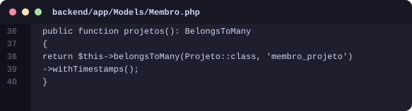
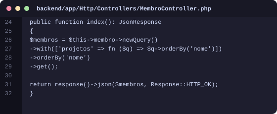
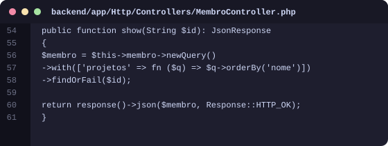
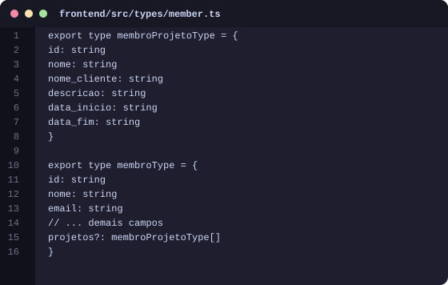
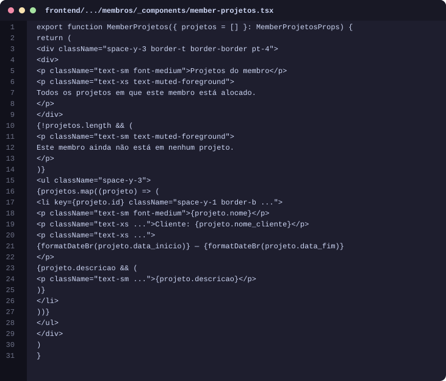
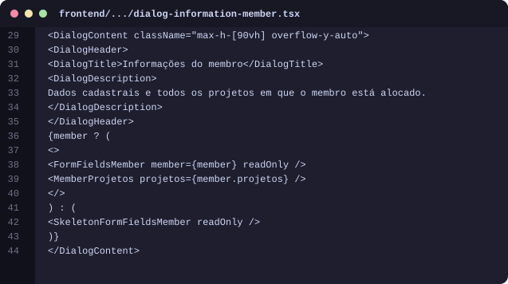
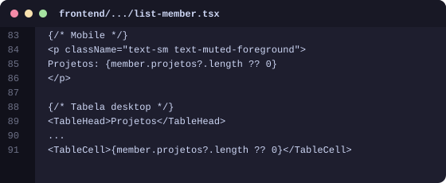
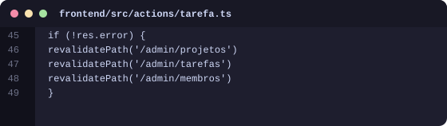

# Projetos do membro — guia com imagens do código

**PS Adapti 2026.2 · material de estudo**

## O que foi pedido

Ao **selecionar / abrir as informações** de um membro, o sistema deve mostrar **todos os projetos** em que ele está alocado — não só o cadastro (nome, e-mail, etc.).

## Ideia em uma frase

A API passa a **entregar os projetos junto com o membro**; o frontend **lista esses projetos** no dialog de informações (ícone ℹ).

## Fluxo (passo a passo)

```
Usuário clica em ℹ no membro
  → Dialog de informações abre
    → Já tem member.projetos (veio do GET /membros)
      → MemberProjetos desenha nome, cliente, datas e descrição
```

Relação no banco (já existia):

```
membros  ←→  membro_projeto  ←→  projetos
```

---

## 1. Relação N:N já existente no model

**Arquivo:** `backend/app/Models/Membro.php` (a partir da linha **36** no código atual)

O Eloquent já sabia que um membro tem muitos projetos via tabela pivot `membro_projeto`. Sem isso, o `with('projetos')` do controller não funcionaria.

### Imagem do código



---

## 2. API lista membros JÁ COM os projetos

**Arquivo:** `backend/app/Http/Controllers/MembroController.php` (a partir da linha **24** no código atual)

`with(['projetos' => ...])` é eager loading: em uma consulta só, o Laravel traz os projetos de cada membro (evita N+1). Ordenamos por nome para a tela ficar previsível.

### Imagem do código



---

## 3. API de um membro também carrega projetos

**Arquivo:** `backend/app/Http/Controllers/MembroController.php` (a partir da linha **54** no código atual)

O `show` (GET /membros/{id}) usa a mesma ideia: se alguém buscar um membro isolado, os projetos já vêm no JSON.

### Imagem do código



---

## 4. Tipos TypeScript — contrato do JSON

**Arquivo:** `frontend/src/types/member.ts` (a partir da linha **1** no código atual)

`membroProjetoType` descreve o resumo do projeto. Em `membroType`, `projetos?` é opcional (array) — bate com o que a API passa a devolver.

### Imagem do código



---

## 5. Componente que desenha a lista de projetos

**Arquivo:** `frontend/.../membros/_components/member-projetos.tsx` (a partir da linha **1** no código atual)

Componente novo e só com essa responsabilidade: receber `projetos` e renderizar nome, cliente, datas (dd/mm/aaaa) e descrição. Se a lista estiver vazia, mostra aviso amigável.

### Imagem do código



---

## 6. Dialog de informações — onde a lista aparece

**Arquivo:** `frontend/.../dialog-information-member.tsx` (a partir da linha **29** no código atual)

Ao clicar no ícone ℹ do membro, o modal mostra o formulário em modo leitura E, logo abaixo, `<MemberProjetos projetos={member.projetos} />`. O `overflow-y-auto` permite rolar se houver muitos projetos.

### Imagem do código



---

## 7. Listagem — contagem de projetos

**Arquivo:** `frontend/.../list-member.tsx` (a partir da linha **83** no código atual)

Na lista (mobile e tabela desktop) aparece quantos projetos o membro tem. O detalhe completo fica no dialog de informações.

### Imagem do código



---

## 8. Atualizar a tela de membros após alocar/desalocar

**Arquivo:** `frontend/src/actions/tarefa.ts` (a partir da linha **45** no código atual)

Quando a equipe de um projeto muda, o Next precisa “invalidar” o cache da página `/admin/membros`. Sem `revalidatePath`, a lista poderia mostrar quantidade antiga.

### Imagem do código



---


## Como testar na tela

1. Entre em **Membros**.
2. Veja a coluna / texto **Projetos** (quantidade).
3. Clique no ícone **ℹ** de um membro que esteja em projetos.
4. Role o modal: abaixo dos dados cadastrais aparece **Projetos do membro** com nome, cliente, período e descrição.
5. Aloque ou remova o membro em **Projetos → Equipe** e volte em Membros: a quantidade e a lista devem atualizar.

## Resumo dos arquivos tocados

| Camada | Arquivo | Papel |
|---|---|---|
| Backend | `MembroController.php` | Eager load de `projetos` no index/show |
| Backend | `Membro.php` | Relação `projetos()` (já existia) |
| Frontend | `types/member.ts` | Tipagem de `projetos` |
| Frontend | `member-projetos.tsx` | UI da lista (novo) |
| Frontend | `dialog-information-member.tsx` | Encaixa a lista no modal |
| Frontend | `list-member.tsx` | Contagem na listagem |
| Frontend | `actions/tarefa.ts` | `revalidatePath('/admin/membros')` |

## Glossário rápido

| Termo | Significado |
|---|---|
| **Eager loading** | Carregar relações no mesmo request (`with`) |
| **Pivot / N:N** | Tabela do meio `membro_projeto` |
| **Dialog** | Modal que abre ao clicar em ℹ |
| **revalidatePath** | Diz ao Next para buscar dados novos naquela rota |

---

*Números de linha batem com o código na data de geração deste PDF. Se você editar o arquivo depois, a linha pode “descer” alguns números — o trecho continua o mesmo.*
